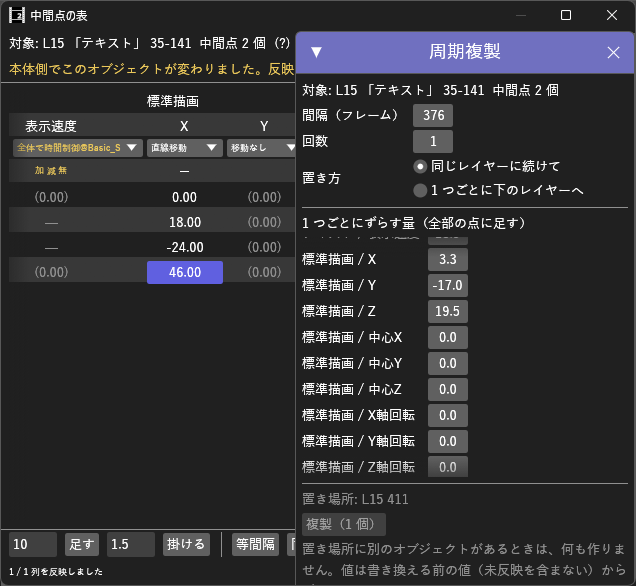

# MidpointTable_H マニュアル



**MidpointTable_H（中間点の表）** は、選んでいるオブジェクトの中間点ごとのトラックバーの値を、表で見て書き換えるプラグイン（Rust 製 `.aux2`）です。行が点（開始・中間点・終了）、列がトラックバーの項目です。値の打ち込み・横ドラッグ・足す / 掛ける / 等間隔・表計算ソフトとのコピー / 貼り付けに加えて、移動方法とその設定（加速・減速・中間点無視・設定値）も表から変えられます。

- **バージョン:** 0.5.3（2026-10-10: 中間点の多いオブジェクト（毎フレームに中間点がある 1800 点など）で、表のウィンドウのスクロール・クリック・ドラッグが重かったのを解消。周期複製・設定のウィンドウをパネルの高さに収め、どこも選んでいないときの Esc で閉じるようにした。タイムラインのメニューの「今のフレームに中間点を足す」は、選んでいるオブジェクト全部に足す。0.5.1 で、開いても出てこなかった右クリックと編集メニューの「表を開く」「中間点の表を開く」を外した。表示メニューから開きます。0.5.0 で、中間点の多いオブジェクトで本体が重くなるのを解消。ウィンドウを出していない間は止まり、本体で変化があったときだけ読み直す。**自動で読み直す** の切り替えを追加）
- **作者:** by HexBrowns
- **必要環境:** AviUtl2 **2.1.11** 以上

書き換えは「**反映**」を押すまで本体に書きません。反映 1 回分は、本体の **元に戻す（Ctrl+Z）1 回** で戻ります。

---

## 開き方

- **表示** メニュー → **中間点の表**（ウィンドウ配置パネルからも選択可）

表示リストに出ない場合は AviUtl2 を再起動してください。

## 導入

1. [Releases](https://github.com/HexBrowns/MidpointTable_H/releases) から `HexBrowns.MidpointTable_H-v0.5.3.au2pkg.zip` をダウンロードし、AviUtl2 のプレビューへドラッグ&ドロップする
   （手で置くなら、中の `Plugin` フォルダをデータフォルダ `C:\ProgramData\aviutl2` へコピーする）
2. AviUtl2 を再起動する
3. **表示** メニュー → **中間点の表** でウィンドウを開く

導入されるのは `Plugin\MidpointTable_H\MidpointTable_H.aux2` だけです。

### ビルド（開発者向け）

リポジトリのルートで [aviutl2-cli](https://github.com/sevenc-nanashi/aviutl2-cli) の `au2` を実行します。
`release/` に、AviUtl2 のプレビューへドラッグ&ドロップして導入できるパッケージ（`.au2pkg.zip`）ができます。

```powershell
au2 release
```

---

## 画面の構成

| 位置 | 内容 |
|------|------|
| 上 | **対象**（レイヤー・名前・範囲・中間点の数）、**(?)**（操作の一覧）、**隠した列 N**（隠している列があるとき）、**今のフレームに中間点を足す**、**周期複製…**、**再読み込み**、**自動で読み直す**。注意があれば黄色・赤で出る |
| 中央 | 表。見出しは上から **効果名**、**項目名**、**移動**（移動方法）、**設定**。その下が点ごとの行（左端はフレーム番号。本体で選んでいる中間点に `▶`）。区間ごとのチェックは右端に並ぶ |
| 下 | **足す** / **掛ける** / **等間隔** / **同じ値** / **コピー** / **貼り付け**、状態表示、**元に戻す**、**反映（N 件）** |

セルの表示:

| 表示 | 意味 |
|------|------|
| `(0.00)`（薄い） | 移動なしの項目。全部の点が同じ値 |
| 黄色 | 未反映の書き換え |
| `—` | 中間点無視（または再生範囲）の途中の点。値は保存されないので編集できない |
| 項目名が黄色 | 注意あり（マウスを乗せると理由が出る） |
| 項目名が薄い | 編集できない形の値（マウスを乗せると理由が出る） |

## 使い方

### 1. 表を出す

タイムラインでオブジェクトをクリックすると、その表が出ます。フォーカスを移すと表も切り替わります（未反映があるときは切り替えず、上に案内を出します）。

本体で値を変える・元に戻す・シーンを切り替えると、表も読み直します。ウィンドウを出していない間は何も読みません（出したときに読み直します）。

**自動で読み直す**（上）を外すと、本体で何をしても表は変わらず、**再読み込み** を押したときだけ、本体で選んでいるオブジェクトの表を読みます。この設定は再起動しても残ります。

### 2. 値を変える

| 操作 | 内容 |
|------|------|
| ダブルクリック / Enter / F2 | 数値を入力。Enter かほかをクリックで確定、Esc で取り消し |
| 横にドラッグ | 1 px で 1 増減。**Shift** で 1/10、**Ctrl** で 10 倍。選んだ範囲の中を掴むと、範囲の全部のセルが同じだけ動く |
| クリック / Shift+クリック | セルを選ぶ / 範囲を選ぶ |
| **足す** / **掛ける** | 左の欄の値を、選んだセルに足す / 掛ける |
| **等間隔** | 列ごとに、選んだ行の最初と最後の間を等しい刻みで埋める |
| **同じ値** | 選んだ範囲を、最初に選んだセルの値にする |
| **コピー** / **貼り付け** | タブ区切りで表計算ソフトとやり取りする。1 セルを選んで貼るとそこを左上にして貼る。範囲を選んで貼るときは大きさが同じときだけ |

**セルを選んでいる間は、Ctrl+C / Ctrl+V / 矢印（Shift で範囲）/ Enter / F2 が表に効き、本体には渡りません**（上に「キー操作: 表」と出ます）。**Esc** で本体へ戻ります。本体の Ctrl+Z やスペースキーを使うときは Esc を押してください。

移動なしの項目で点ごとに違う値にすると、反映したときに **直線移動** になります（**移動** の段で別の移動方法を選べます）。

### 3. 移動方法を変える（「移動」の段）

プルダウンから選びます。一番上の欄で絞り込めます。

- **移動なし**: 全部の点が同じ値のときだけ選べる
- **（使用中）**: この表の列が今使っている移動方法
- それ以外: 本体に登録されている移動方法（組み込み・本体同梱・`Script\` の `.tra2`）。`*` は設定値があるもの

別の移動方法に変えると、加速・減速と設定値は初期値に戻ります。

### 4. 設定を変える（「設定」の段）

ボタンに今の設定（`加` `減` `無` と設定値）が出ます。押すと **設定** ウィンドウが開きます（もう一度押すか、×、またはどこも選んでいないときの **Esc** で閉じる）。

| 項目 | 内容 |
|------|------|
| 加速 / 減速 | 本体の設定ダイアログの加速・減速と同じ |
| 中間点無視（始点と終点だけ） | 入れると途中の点が `—` になり、始点と終点だけで動く |
| 設定値 | 移動方法の設定値。名前・チェック・選択肢は `.tra2` の定義から出す。組み込みでは **ランダム移動** だけ「設定値1」として出る |
| 初期値に戻す | 設定値を定義の初期値にする |

### 5. 中間点を足す・動かす・消す

**すぐに本体へ書きます**（反映は要りません。1 回の操作が本体の元に戻す 1 回分）。未反映の書き換えがある間は使えません。

| 操作 | 内容 |
|------|------|
| 上の **今のフレームに中間点を足す** | 本体で表示しているフレームに中間点を足す。足した点には、その時点の値が入る（動きは変わらない） |
| フレーム番号を右クリック → **次の点とのあいだ（N）に中間点を足す** | その点と次の点の真ん中に足す |
| 中間点のフレーム番号をダブルクリック（または右クリック → **位置を変える…**） | フレーム番号を入力して動かす。値は点と一緒に動く。前後の点を越えては動かせない |
| 中間点のフレーム番号を右クリック → **この中間点を消す** | その点と、その点の値を消す |
| タイムラインでオブジェクトを右クリック → **プラグイン** → **中間点の表** → **今のフレームに中間点を足す** | 表を開かずに足す。選んでいるオブジェクト**全部**に足し（今のフレームが範囲の外のものは飛ばす）、結果を表のウィンドウの下に出す |

開始点・終了点は表からは動かせません（タイムラインで動かしてください）。

### 6. 区間ごとのチェック

スクリプトの **区間ごとのチェックボックス**（`--checksection`）は、表の右端にチェックの列として出ます。各行は、**その点から始まる区間**の値です（最後の行には区間がありません）。切り替えると未反映になり、**反映** でまとめて書きます。

### 7. 列を隠す・並べ替える

- **隠す**: 列の見出し（項目名）を右クリック → **この列を隠す**。上の **隠した列 N** から戻せます
- **並べ替える**: 列の見出しを左右に**ドラッグ**する（入る位置に黄色の縦線が出ます）。または右クリック → **左へ** / **右へ**。**（効果名）の列を元の並びに戻す** で元に戻ります。並べ替えられるのは同じ効果の中だけです

どちらも**どのオブジェクトでも**同じになります（効果名と項目名で覚えます）。未反映の書き換えがある間は変えられません。

### 8. 周期複製

上の **周期複製…** を押すと、**周期複製** ウィンドウが開きます。表のオブジェクトを一定の間隔で複製し、値を 1 つごとにずらします。

| 項目 | 内容 |
|------|------|
| 間隔（フレーム） | 複製どうしの開始位置の差。既定はオブジェクトの長さ（すき間なく並ぶ） |
| 回数 | 1〜100 |
| 置き方 | **同じレイヤーに続けて**（間隔は長さ以上）／**1 つごとに下のレイヤーへ**（間隔 0 なら同じ時刻に積む） |
| 1 つごとにずらす量 | 列ごと。k 個目は、その列の全部の点に「ずらす量 × k」を足す（例: X に 100 なら 100, 200, 300 …） |

- 複製は中間点・効果・設定ごと元を写します。ずらす量は、表で書き換える前の値（未反映を含まない）から計算します
- 置き場所に別のオブジェクトが 1 つでもあると、**何も作らずに**知らせます
- **複製（N 個）** を押すとすぐ本体に書きます。本体の元に戻す 1 回で、まとめて消えます
- ウィンドウはパネルの高さに収まるように縮み、**1 つごとにずらす量** の一覧がスクロールになります。× のほか、どこも選んでいないときの **Esc** で閉じます（設定ウィンドウも開いていれば、そちらが先に閉じます）
- 数値の欄は、Enter かほかをクリックしたときに確定します。入力中の **Esc** は入力を取り消し、ウィンドウは閉じません（設定ウィンドウと、下の **足す** / **掛ける** の欄も同じ）

### 9. 反映する

**反映（N 件）** を押すと、書き換えた列をまとめて本体に書きます。N は書き換えたセル、移動方法・設定を変えた列、切り替えた区間ごとのチェックの数です。

- **元に戻す**（ウィンドウ下）: 未反映の書き換えを捨てます。本体の「元に戻す」とは別です
- 反映の直前に、本体側でその項目が変わっていたら、その列は書かずに知らせます
- 範囲の外の値（例: 表示速度に 1000）は、本体が範囲に収めて保存します。そのときは状態表示に「本体が値を変えて保存しました」と出ます

---

## 注意事項・制限

- 対象はフォーカス中のオブジェクト 1 つです。表示中のシーンだけを編集できます
- 移動方法の一覧は AviUtl2 の起動時に作ります。起動後に置いた `.tra2` は、再起動するまで一覧に出ません（本体も再起動まで読み込まないため）
- 設定値の数が移動方法の定義と違う形で保存されているもの、時間制御のデータを持つものは、設定値を編集できません（加速・減速・中間点無視は変えられます）
- 区間ごとのチェックは、区間が 2 つ以上あるオブジェクトでだけ出ます（区間が 1 つだと普通のチェックと見分けがつかないため）。普通のチェックボックスは出ません
- 隠す列・並び順・**自動で読み直す** の設定は `Plugin\MidpointTable_H\hidden_columns.txt` に保存されます
